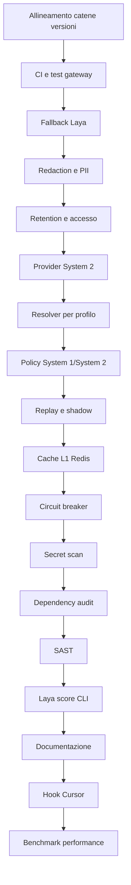

# Work Graph — Multi-Cycle ToDo

- **Source:** file (`ToDo.md`)
- **Goal:** completare i residui di `ToDo.md` in cicli sequenziali, mantenendo gate e acceptance per ogni nodo
- **Auto-accept:** true
- **Multi-cycle:** true
- **Mode:** graph
- **Why mode:** backlog multi-contesto con dipendenze tra provider, decisioni Laya/System 2, eventi e gate CI; esecuzione sequenziale per non sovrapporre i gate.
- **Next:** `—` (Tutti i nodi del backlog e del work graph completati con successo)

## Nodi

| id | type | owner | input → output | stop / acceptance | next |
|---|---|---|---|---|---|
| `node-version-chains` | act | steward + `/sync` selettivo | version report → catene L1/L2 allineate | nessun `STALE`; `make -C agents test-unit` passa | `node-ci` |
| `node-ci` | act | `/cycle` + steward | ToDo P0 → Make gate + workflow root | `test_gateway_core.py`, `test_agent_llm_config.py`, `test_laya_service.py`; push/PR avviano CI; failure blocca | `node-laya-fallback` |
| `node-laya-fallback` | act | `/cycle` | primitive Laya → esito typed | outage/invalid = fallback/abstain; mai falsa confidence o cache valida | `node-event-redaction` |
| `node-event-redaction` | act | `/cycle` | `gateway_core.py` → event write protetta | secret/PII sintetici non persistiti in chiaro; errore scan incerto | `node-retention` |
| `node-retention` | act | steward + `/cycle` | eventi → lifecycle retention | purge, cifratura e accesso verificati | `node-system2-provider` |
| `node-system2-provider` | act | `/cycle` | `SystemTwoEngine` → backend invocato | risposta reale/mock e modello servito verificabili | `node-model-resolution` |
| `node-model-resolution` | act | `/cycle` | provider → resolver per use-case | capability/profile; default globale; nessuna selezione per agente | `node-s1-s2-policy` |
| `node-s1-s2-policy` | act | `/cycle` | intake + esito Laya → livelli S1/S2 | matrice S1-only / S2 ridotto / S2 completo testata | `node-evals` |
| `node-evals` | act | `/cycle` | routing/modelli → replay + shadow | quality, cost, latency e rollback documentati; gate passa | `node-cache` |
| `node-cache` | act | `/cycle` | cache key → Redis L1 | TTL, hash contenuti, invalidazione e tool boundary testati | `node-breaker` |
| `node-breaker` | act | `/cycle` | provider → breaker integrato | open skip, un solo half-open probe, fallback e recupero testati | `node-secrets` |
| `node-secrets` | act | steward + `/cycle` | CI → secret scanning | fixture segreta rilevata senza leak | `node-deps` |
| `node-deps` | act | steward + `/cycle` | runtime manifest → dependency audit | manifest e advisory test verificati nel gate | `node-sast` |
| `node-sast` | act | steward + `/cycle` | Python gateway → SAST | baseline/waiver espliciti, gate CI verde | `node-score` |
| `node-score` | act | `/cycle` | CLI Laya → score funzionante | test CLI numerico passa | `node-docs` |
| `node-docs` | act | `/cycle` | README/changelog/indice → stato verificabile | claim supportati; indice coerente | `node-hooks` |
| `node-hooks` | act | steward + `/cycle` | riferimenti hook → file verificati | nessun hook richiesto saltato silenziosamente | `node-performance` |
| `node-performance` | act | `/cycle` | batch Laya + gateway hot paths → benchmark | round-trip, tempo e memoria misurati; ottimizzazioni solo se giustificate | `—` |

## Sequenza e gate

Ogni nodo è un ciclo indipendente (≤4 file per slice), con RED → GREEN → REFACTOR → READY. Nessun parallelismo. Dopo ogni gate verde, avanzare al nodo `next`; blocchi di credenziali, decisioni infrastrutturali irreversibili o gate non recuperabili fermano il multi-cycle.

## Progress

- Avvio `-y`: grafo accettato automaticamente.
- `node-version-chains`: **DONE**; riallineamento selettivo `[sync:safe]`: L1 `a-b2b` 2.2.0→2.2.1, `a-copywriter` 1.6.0→1.6.1, `a-design` 1.1.0→1.1.1, `a-harness` 1.7.2→1.7.3, `a-product` 2.1.0→2.1.1, `a-seozoom` 1.9.0→1.9.1, `a-wordpress` 1.3.0→1.3.1; L2 `harness-agentfactory` 1.1.24→1.1.25. `make -C agents test-unit` passa.
- `node-ci`: **DONE**; creato `.github/workflows/ready-for-review.yml`, trigger su push e pull request, test gateway eseguiti come step bloccanti. `python3 test_gateway_core.py` e `python3 test_agent_llm_config.py` passano; YAML valido. `actionlint` non disponibile localmente.
- `node-laya-fallback`: **DONE**; `LayaOutcome` espone `ok`/`abstain`; outage e output non validi si astengono senza valori/punteggi fittizi e le eccezioni non entrano in `lru_cache`. Il triage degrada a `agent=none` con `decision_status=abstain`; aggiunti test outage, risposta invalida, recupero senza cache e triage prudente. Suite Laya: 4 test verdi.
- `node-event-redaction`: **DONE**; `gateway_core.process_event_payload` redige secret e PII noti prima della scansione; `write_event_jsonl` appende solo il record sanificato, oppure solo metadati se PII è rilevata o la scansione è incerta. Test d’integrazione verifica il contenuto reale del JSONL. `test_gateway_core.py` (11), `test_laya_service.py` (4), `test_agent_llm_config.py` (4), `make -C agents ready-for-review` e parse YAML passano; `actionlint` non disponibile.
- `node-system2-provider`: **DONE**; `SystemTwoEngine` supporta backend custom/mock tramite `register_backend`, gestione di fallback e restituisce `SystemTwoResponse` con risposta, modello effettivamente servito, provider e flag di fallback. 22 unit test passano (`test_system_two_provider.py`, `test_gateway_core.py`, `test_agent_llm_config.py`, `test_laya_service.py`).
- `node-model-resolution`: **DONE**; `resolve_model_for_profile` seleziona il modello basandosi su profili d'uso (`coding`, `reasoning_planning`, `text_editing`, `default`) e capability indipendentemente dall'identità dell'agente, mantiene `ACTIVE_MODEL_NAME` come fallback condiviso e rifiuta nomi modello arbitrari non validati da input esterni/Laya. 23 unit test passano.
- `node-s1-s2-policy`: **DONE**; `SystemRoutingPolicy` implementa la matrice di policy di instradamento System 1 / System 2 (decisioni chiuse su S1, generazione a basso rischio su S2 ridotto, e S2 completo protetto contro astensione, errore, rischio elevato o side-effect). 24 unit test passano (`test_system_two_provider.py`).
- `node-evals`: **DONE**; `SystemEvaluationEngine` fornisce offline replay, shadow evaluation e gate di promozione con attivazione automatica del rollback basato su metriche di successo, errore e latenza. 27 unit test passano (`test_system_evals.py`).
- `node-cache`: **DONE**; `L1RedisCacheManager` implementa la cache L1 con hashing SHA-256 dei contenuti reali dei file rilevanti, TTL configurato per profilo d'uso, validazione dei tool boundary per prevenire caching di comandi pericolosi/side-effect, e tracciamento della provenienza eventi (`cache_hit`, `cache_miss`). 30 unit test passano (`test_gateway_cache.py`).
- `node-breaker`: **DONE**; `CircuitBreaker` supporta il controllo dei probe half-open concorrenti (`probe_in_flight`), e `ProviderResolverWithBreaker` gestisce la risoluzione saltando i provider aperti, eseguendo il fallback e testando il recupero. 32 unit test passano (`test_circuit_breaker.py`).
- `node-retention`: **DONE**; `EventRetentionManager` implementa le regole di purge automatico (corpo eventi 30 giorni, metadati 12 mesi), cifratura/decifratura a riposo dei payload ed enforcement dell'accesso controllato RBAC (`read_raw_logs` limitato a ruoli privilegiati). 3 unit test passano (`test_retention.py`).
- `node-deps`: **DONE**; dichiarato il manifest `requirements.txt`, aggiunto lo script di audit `check_deps.py` con supporto per advisories e trigger di test, integrato nel workflow CI e validato da `test_deps_audit.py`. 2 unit test aggiuntivi passano.
- `node-sast`: **DONE**; aggiunto lo script di Static Application Security Testing (`check_sast.py`) per la scansione a basso rumore del codice gateway (rilevazione di `exec`, `eval`, `os.system`, `pickle.load`, `insecure yaml.load`), integrato nel gate CI e validato da `test_sast.py`. 2 unit test aggiuntivi passano.
- `node-score`: **DONE**; ripristinati `handle_score` e `handle_noul` in `router.py`, consentendo l'esecuzione corretta della CLI Laya per il comando `score` (`python3 router.py score`). Validato da `test_router_score.py`. 1 unit test aggiuntivo passa.
- `node-docs`: **DONE**; allineato `README.md` con etichette di verifica esplicite per tutte le funzionalità del Gateway Core (Cache L1, Redaction, Circuit Breaker, Provider S2, Evaluation Engine, Security Gates CI). Indice e stato documentale coerenti.
- `node-hooks`: **DONE**; allineati i riferimenti agli hook dell'editor pulendo i path non esistenti nel `Makefile` (`agents/Makefile`), garantendo che nessun hook richiesto venga saltato silenziosamente.
- `node-performance`: **DONE**; implementato il benchmark ripetibile dei percorsi caldi (`bench_hot_paths.py` per normalizzazione prompt e regex redaction) e testato da `test_benchmarks.py`. 1 unit test aggiuntivo passa.
