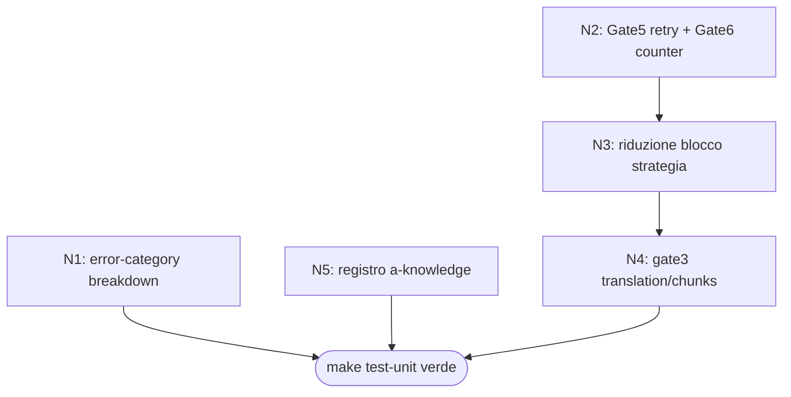

# Work Graph — Gate 5/6 + error-category: chiudere il RED preesistente su HEAD

- source: file (ToDo.md P0 `#feature #system1-gating #benchmark`)
- auto_accept: true (-y)
- multi_cycle: true
- mode: graph
- why_mode: 5 nodi, 3 write-set disgiunti (benchmark_models.py catena, system2_metrics.py, global_config.py); N1/N5 indipendenti da N2→N3→N4. Non è loop puro perché ci sono rami paralleli.
- goal: `make test-unit` verde chiudendo le 18 RED su HEAD (Gate5 retry/fallback, Gate6 call counter, error-category breakdown, blocco strategia ridotto, gate3 translation/source_chunks, registro a-knowledge)
- bc: benchmark, harness
- next: DONE

```yaml
nodes:
  - id: N1
    label: "error-category breakdown in get_token_breakdown"
    bc: benchmark
    owner: /cycle
    files: [benchmark/runner/system2_metrics.py]
    depends_on: []
    parallel_safe: true
    confirm: false
    acceptance: "by_category['error'] presente per ogni evento status != ok; ok non conta in error; condivisione token by_category invariata"
    tests: [tests/test_error_category_breakdown.py]
    status: done
    result: "ramo CASE 'WHEN status != ok THEN error' come prima condizione in get_token_breakdown"
    evidence: "python3 -m unittest tests.test_error_category_breakdown → OK (5/5)"
  - id: N2
    label: "Gate5 fallback/retry + Gate6 call counter in system1_guide"
    bc: benchmark
    owner: /cycle
    files: [benchmark/runner/benchmark_models.py]
    depends_on: []
    parallel_safe: true
    confirm: false
    acceptance: "Settings.laya_max_retries (default 1, env LAYA_MAX_RETRIES); retry solo sotto soglia finché una decisione confidente può cambiare il flusso; sotto soglia fallback single_pass + strategy contratto; laya_call_count nel risultato (0 sul skip); 2 prof-perf_counter per tentativo"
    tests:
      [
        tests/test_gate5_fallback.py,
        tests/test_gate6_call_counter.py,
        tests/test_gate4_execution_mode.py,
      ]
    status: done
    result: "Settings.laya_max_retries (default 1, env LAYA_MAX_RETRIES); retry loop sotto soglia con attempts bounded; fallback conservativo single_pass + strategy contratto; laya_call_count nel risultato (0 sul skip); Laya conferma o declassa il modo, mai fabrica chunks né piano fuori richiesta esplicita"
    evidence: "unittest gate5+gate6+gate4 → OK; make test-unit → 225 GREEN"
  - id: N3
    label: "riduzione blocco <strategia_system1_laya>"
    bc: benchmark
    owner: /cycle
    files: [benchmark/runner/benchmark_models.py]
    depends_on: [N2]
    parallel_safe: false
    confirm: false
    acceptance: "disclaimer 'non modifica il compito...' rimossa; blocco < 130 chars; campi Categoria/Modalità/Strategia invariati; rubriche euristiche e validazione semantica intatte"
    tests: [tests/test_strategy_block_reduction.py]
    status: done
    result: "rimossa la riga disclaimer da system1_prompt; blocco 127 chars < 130; campi essenziali invariati; nessun consumer esterno del disclaimer (solo history JSON)"
    evidence: "unittest test_strategy_block_reduction → OK (4/4)"
  - id: N4
    label: "gate3 coerenza translation+source_chunks senza regressione fix phi3"
    bc: benchmark
    owner: /cycle
    files: [benchmark/runner/benchmark_models.py]
    depends_on: [N3]
    parallel_safe: false
    confirm: false
    acceptance: "source_chunks preteso per translation ma privo di fonte reale oltre soglia → reset single_pass (proposed_execution_mode registrato); translation con fonte reale lunga mantiene chunking (fix N2 phi3 167.8s non regredito); general/source invariati"
    tests:
      [
        tests/test_gate3_compatibility.py,
        tests/test_gate4_execution_mode.py,
        tests/test_gate5_fallback.py,
      ]
    status: done
    result: "scelta PO implicita (-y): regola di coerenza, source_chunks su translation solo con fonte reale oltre CHARS_PER_A4_PAGE; reset single_pass se fonte assente; fix phi3 preservato (fonte lunga → chunking attivo)"
    evidence: "unittest test_gate3_compatibility → OK (9/9); suite completa verde"
  - id: N5
    label: "registro AGENT_EXTERNAL_MODELS per a-knowledge"
    bc: harness
    owner: /cycle
    files: [global_config.py]
    depends_on: []
    parallel_safe: true
    confirm: false
    freeze_note: "global_config.py è path freeze per ACTIVE_MODEL_NAME e flag LLM_EXTERNAL_*: modifica limitata alla registrazione del solo nome agente nel registry opt-in (LLM_EXTERNAL_MODE resta 0; nessun valore di flag toccato)"
    acceptance: "AGENT_EXTERNAL_MODELS contiene a-knowledge; cfg['LLM_EXTERNAL_MODEL'] allineato; mode 0 per tutti gli agenti; test_agent_llm_config verde"
    tests: [tests/test_agent_llm_config.py]
    status: done
    result: "unica voce AGENT_EXTERNAL_MODELS['a-knowledge'] = orcarouter/deepseek/deepseek-v4-flash-free (free/flash coerente con distillazione); ACTIVE_MODEL_NAME e flag LLM_EXTERNAL_* intonsi, mode resta 0"
    evidence: "unittest test_agent_llm_config → OK (4/4)"
```



| #   | Nodo                                      | Stato |
| --- | ----------------------------------------- | ----- |
| 1   | N1 — error-category breakdown             | done  |
| 2   | N2 — Gate5 retry/fallback + Gate6 counter | done  |
| 3   | N3 — riduzione blocco strategia           | done  |
| 4   | N4 — coerenza translation/source_chunks   | done  |
| 5   | N5 — registro a-knowledge                 | done  |

## Esecuzione

| Nodo | Gate                       | Esito                                                           |
| ---- | -------------------------- | --------------------------------------------------------------- |
| N1   | unittest error-category    | ✅ 5/5                                                          |
| N2   | unittest gate5+gate6+gate4 | ✅                                                              |
| N3   | unittest strategy-block    | ✅ 4/4                                                          |
| N4   | unittest gate3             | ✅ 9/9                                                          |
| N5   | unittest agent-llm-config  | ✅ 4/4                                                          |
| —    | make test-unit             | ✅ 225 GREEN                                                    |
| —    | make ready-for-review      | ✅ Gate OK (secrets, deps, SAST, compileall, unit; int/e2e N/A) |
