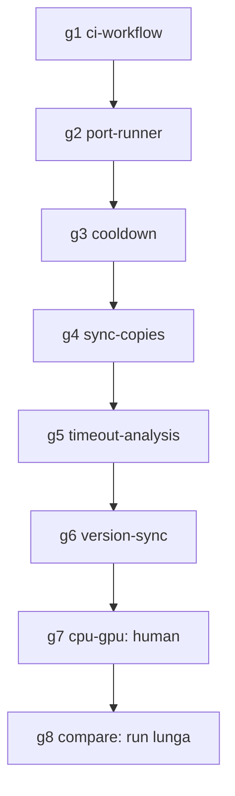

# Work Graph — Backlog ToDo (gateway + benchmark)

- **Source:** file (`ToDo.md`, tutte le voci aperte P1/P2)
- **Goal:** chiudere ciò che è chiudibile senza decisioni umane né run di benchmark da ore; documentare i blocchi residui.
- **BC:** HAL Gateway (infra CI, routing S1/S2) e benchmark (runner, generatore, telemetria)
- **Auto-accept:** true (`-y`)
- **Multi-cycle:** true, sequenziale
- **Mode:** loop
- **Why mode:** nessun parallelismo sicuro (le due copie del runner e `ToDo.md` sono file condivisi tra i nodi); un solo owner operativo. Un DAG sarebbe graph-trap.
- **Next:** `g7-cpu-gpu` — **hard stop umano** (g1–g6 completati)
- **Verified:** 97 test gateway, 190 test `hal_system2`, 20 comandi CI da root exit 0, `sync_hal_system2.sh check` exit 0. Non verificato: esito su GitHub Actions; `make -C agents version-chains` fallisce per STALE preesistente (nuova voce ToDo `#version-sync`).

## Stato ereditato (`#system1-gating`)

- Fatti: `cycle-baseline`, `cycle-preflight` (gate 1 anche in `is_atomic_short_low_risk`), `cycle-budget` (gate 5/6 lato gateway).
- Telemetria (gate 7): già implementata nel runner (`System2Metrics`, 311 eventi su 11 run); non c'è un equivalente nel gateway e non serve copiare il runtime.
- **Discrepanza aperta:** `handoff-graph.json` (2026-10-18) dà `cycle-coherence` completato, ma `LayaSystemOneService.coherence` è ancora uno stub (`coherence_ok` sempre). Il gate 3/4 effettivo vive in `system1_guide` del runner. Non avanzare su questo senza una decisione sul dove implementarlo.

## Esito nodi

- g1 CI: completato.
- g2: il canonico `hal_system2` conteneva già un superset; il gateway è stato riallineato (`diff` vuoto) e la mia implementazione parallela ritirata.
- g3: `--cooldown` nel canonico + mirror, 3 test nuovi (suite 190 verdi, non committata in `hal_system2`).
- g4: `sync_hal_system2.sh check|apply`, 6 test.
- g5: causa del tempo >600 s documentata; limite-vs-modello resta aperto (serve run).
- g6: versione wrapper da frontmatter canonico, idempotente, 6 test.
- g7/g8: **non eseguiti** (hard stop).

## Loop Spec

| id                    | owner                         | output                                                                                                                                         | stop                                                                  | next                  |
| --------------------- | ----------------------------- | ---------------------------------------------------------------------------------------------------------------------------------------------- | --------------------------------------------------------------------- | --------------------- |
| `g1-ci-workflow`      | `/slice` · `#infra`           | step test di `.github/workflows/ready-for-review.yml` corretti (`PYTHONPATH=. python3 -m unittest tests.<modulo>`), aggiunti i moduli mancanti | ogni comando del workflow lanciato dalla root esce 0                  | `g2-port-runner`      |
| `g2-port-runner`      | `/slice` · `#benchmark`       | assemblaggio locale `translation` + blocco strategia ridotto portati in `hal_system2/app/benchmark_models.py`; test `source_chunks` aggiornato | `diff` tra le copie vuoto; test `hal_system2` verdi                   | `g3-cooldown`         |
| `g3-cooldown`         | `/slice` · `#benchmark`       | `--cooldown SECONDI` tra i modelli nel runner (due copie) + test                                                                               | test verdi; `diff` copie vuoto                                        | `g4-sync-copies`      |
| `g4-sync-copies`      | `/slice` · `#benchmark` P2    | script `benchmark/scripts/sync_hal_system2.sh check\|apply` per generatore e runner                                                            | `check` esce 0 dopo `apply`, ≠0 se divergono                          | `g5-timeout-analysis` ✅ |
| `g5-timeout-analysis` | `/cycle` doc-only             | causa dei timeout documentata dalla telemetria                                                                                                 | `ToDo.md` aggiornato con evidenza                                     | `g6-version-sync`     |
| `g6-version-sync`     | `/slice` · `#version-sync` P2 | una sola sorgente della versione dei wrapper in `link-workspace-skills.sh`                                                                     | due sync consecutivi idempotenti; test di regressione                 | `g7-cpu-gpu`          |
| `g7-cpu-gpu`          | `human`                       | run con Laya su CPU, stessa pausa, per isolare l'effetto                                                                                       | **hard stop**: richiede cambio hardware/servizio di Laya              | `g8-compare`          |
| `g8-compare`          | `/cycle`                      | run baseline/candidato con modello e test per coppia                                                                                           | **hard stop**: richiede run da ore (4 modelli, pausa 300 s) dopo `g2` | `—`                   |

**Hard stop:** `stuck@3`, gate Make non recuperabile, scelta umana, run lunghe. Ogni slice ≤4 file salvo waiver.

