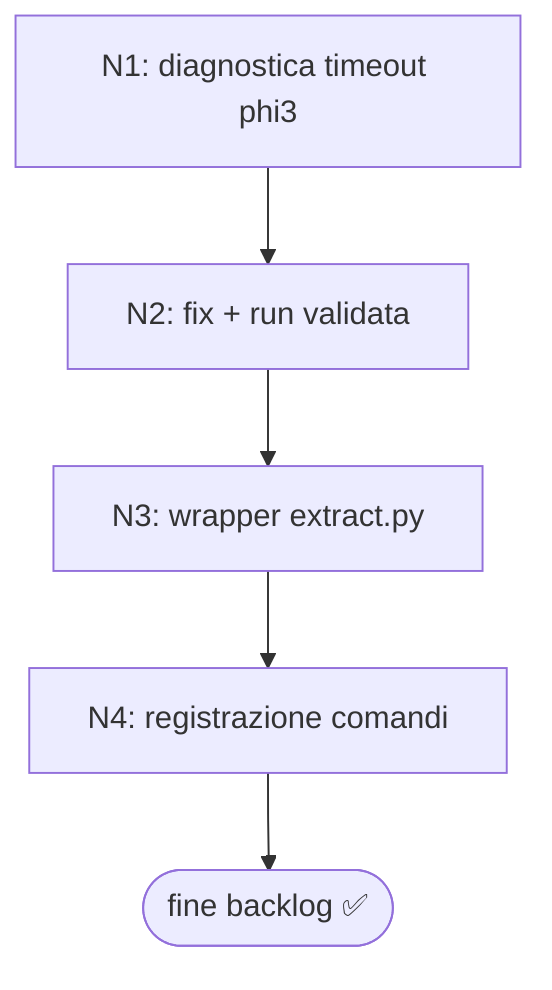

# Work Graph — Backlog corrente (ToDo.md)

- source: file
- auto_accept: true
- multi_cycle: true
- mode: loop
- why_mode: Due item indipendenti ma con owner/risorsa comune (agent `/cycle`, GPU Quadro M2200). Serialità per la run benchmark; a-knowledge è solo codice locale (nessuna GPU). Path lineare RGR → Loop, non grafo (anti graph-trap).
- goal: risolvere timeout phi3 sintesi_traduzione + consegnare wrapper a-knowledge + registrazione comandi
- bc: benchmark, knowledge
- next: DONE — multi-cycle (-y) completo

## Loop Spec

**Context pack (≤4 file + evidence):**

- `benchmark/runner/benchmark_models.py` (runner, CLI `--model/--prompt/--timeout/--cooldown`)
- `benchmark/history/20261023_8/` (run timeout phi3 sintesi_traduzione)
- `a-knowledge/scripts/extract.py` (estrattore da wrapperizzare)
- `agents/skills/a-knowledge/SKILL.md` (comandi da registrare)

**Error triage:**

- Recuperabile: timeout singolo → retry con `--timeout` più alto o chunking input; errore script → fix locale.
- Hard blocker (ferma il loop): GPU OOM, modello mancante, `stuck@3` sullo stesso approccio.

**Termination:** tutti gli item `[x]` con evidenza scritta, oppure hard stop.

**Mapping AF:** ogni step = `/cycle` (R→G→Rf dove applicabile; per spike di sola misura: run → registra → conclusione).

## Steps (ordine deterministico)

| id  | type  | owner | in                                   | out                                                                       | stop                                    | next    |
| --- | ----- | ----- | ------------------------------------ | ------------------------------------------------------------------------- | --------------------------------------- | ------- |
| N1  | cycle | agent | P1: timeout phi3 sintesi_traduzione  | diagnostica causa timeout (chunking? prompt? memoria?) + run confermata   | root cause identificata + run/debug log | ✅ DONE |
| N2  | cycle | agent | P1: fix timeout + run validata       | run phi3 sintesi_traduzione completa < 3600s; token/min_chars riportati   | run ok + durata/token registrati        | ✅ DONE |
| N3  | cycle | agent | P2: wrapper extract.py cost-aware    | script wrapper con --check + selezione estrattore + routing capitolo Laya | script eseguibile + test base           | ✅ DONE |
| N4  | cycle | agent | P2: registrazione comandi /knowledge | doc + hook per check\|extract\|distill\|query\|update                     | registrazioni valide                    | ✅ DONE |

## Esecuzione `-y` completata

| Nodo | Stato | Risultato                                                                                                                                     |
| ---- | ----- | --------------------------------------------------------------------------------------------------------------------------------------------- |
| N1   | ✅    | Root cause: `TASK_FAMILY_ALLOWED_MODES[translation] = [single_pass]` → nessun chunking possibile; phi3 ~26× più lento di llama su single_pass |
| N2   | ✅    | Fix gate applied (`source_chunks` aggiunto); phi3:mini OK in 167.8s (prima 3600s timeout). Token: 2661 tot (in 2050/out 611)                  |
| N3   | ✅    | `scripts/extract.py` creato con `--check`, selezione estrattore cost-aware, cache sha256, routing Laya                                        |
| N4   | ✅    | `.zed/prompts/knowledge.md` registrato con check\|extract\|distill\|query\|update                                                             |
