# Work Graph — Mappa residui 2026-10-28 (Kimi dynamic tools + QwenCloud multi-turn / cache / pooling / async / streaming)

- source: file (ToDo.md — 36 voci: 1 P0, 13 P1, 22 P2; post-flush 2026-10-28: 8 aperte; re-run /graph -y 2026-10-29: 7 aperte = residuo N23-N28 + marker cache_control come N29; re-run /graph -y 2026-10-30 su ToDo.md: 0 voci aperte in P0/P1/P2, prose dei delta obsolete, buffer «Già fatto» vuoto, flush già in CHANGELOG)
- auto_accept: true (-y)
- multi_cycle: true
- mode: graph
- why_mode: voce Laya choice = ABSTAIN (servizio non raggiungibile, come da nota nel backlog stesso); regola System 2 applicata: non è Loop singolo perché la serie copre 5 BC con owner e write-set distinti (Gateway Core, System 1 Laya, Benchmark, Skill illustrator, Agent Platform/bundle), fan-out indipendente fra catene e dipendenze interne (P0 chiave cache -> due livelli -> instructions; ordering -> marker; streaming backend -> deltas -> serving). Grafo = orchestrazione deterministica, non runtime secondo harness (pin graph-loop-source).
- goal: chiudere il backlog 2026-10-28 con `make test-unit` verde e `make ready-for-review` a 0, un nodo = uno slice (perimetro fino a 4 file o WAIVER dichiarato), marcando le voci ToDo concluse
- bc: Gateway Core, System 1 (Laya), Benchmark, Observability & Retention, Agent Platform (bundle `agents/`)
- next: DONE — backlog 2026-10-28/29 esaurito (7/7 voci ToDo chiuse, 0 aperte; flush 7 voci in CHANGELOG; confermato re-run /graph -y 2026-10-30: fine backlog deterministico, nessun Act)

Catene di esecuzione (vincolo = condivisione file oltre che dipendenza funzionale; si corre in ordine N0→N28):

```mermaid
flowchart TD
  N0([N0 gate: contratto versione 1.9.1]) --> N1[N1 P0: chiave cache L1 include tool e skill]
  N1 --> N2[N2 chiave due livelli prefix e suffix]
  N2 --> N3[N3 system prompt come instructions e contratto ordine blocchi]
  N3 --> N4[N4 registry tool session-scoped append-only]
  N4 --> N5[N5 ContextManager multi-turn]
  N5 --> N6[N6 filtro reasoning_content]
  N6 --> N7[N7 merge messaggi tool same-role]
  N7 --> N8[N8 retry Laya con backoff e jitter]
  N8 --> N9[N9 HTTPAdapter pool e timeout disaccoppiati]
  N9 --> N10[N10 teardown session e CA bundle]
  N10 --> N11[N11 illustrator: poll backoff, stati terminali, multi-output]
  N11 --> N12[N12 idempotenza submit task_id]
  N12 --> N13[N13 budget polling task 20 QPS]
  N13 --> N14[N14 capability flag dynamic_tools, prefix_caching, context_cache, streaming_only]
  N14 --> N15[N15 backend streaming SSE System 2]
  N15 --> N16[N16 accumulo delta tool_calls e JSON mode]
  N16 --> N17[N17 docs vincoli serving SSE]
  N17 --> N18[N18 telemetria cached_tokens]
  N18 --> N19[N19 prezzi cache effettivi per modello e regione]
  N19 --> N20[N20 costo refill cache nel failover]
  N20 --> N21[N21 catalogo skill compatto tool-search Laya]
  N21 --> N22[N22 regole protocollo bundle: append-only, reasoning, ordering, retention]
  N22 --> N23[N23 regola task-vs-batch System 1]
  N23 --> N24[N24 client riusato negli script skill]
  N24 --> N26[N26 spike metrica connection reuse]
  N26 --> N27[N27 spike token per richiesta vs catalogo]
  N27 --> N28[N28 spike session cache header via OrcaRouter]
  N28 --> N25[N25 spike astrazione conversation]
  N25 --> N29[N29 marker cache_control a due strati]
  N29 --> DONE([make ready-for-review verde])
```

## Nodi

| id  | tipo   | owner  | bc                        | files (perimetro)                                                                                                                             | acceptance (sintesi, body completo in ToDo.md)                                                                                                                                                                                                                                                                     | stop                                                            | next |
| --- | ------ | ------ | ------------------------- | --------------------------------------------------------------------------------------------------------------------------------------------- | ------------------------------------------------------------------------------------------------------------------------------------------------------------------------------------------------------------------------------------------------------------------------------------------------------------------ | --------------------------------------------------------------- | ---- |
| N0  | act    | /cycle | DevSecOps Tooling         | tests/test_a_harness_static_policy.py                                                                                                         | contratto accetta a-harness 1.9.1 senza rimpiazzare il pin con assenza di check                                                                                                                                                                                                                                    | test ancora RED                                                 | N1   |
| N1  | act    | /cycle | Gateway Core              | gateway_core.py, tests/ (chiave L1)                                                                                                           | T01: dichiarazioni tool e skill nella chiave; due richieste stesso testo tool diversi => chiavi diverse                                                                                                                                                                                                            | falso hit residuo                                               | N2   |
| N2  | act    | /cycle | Gateway Core              | gateway_core.py, docs/07_cache_l1.md, tests/                                                                                                  | T02: prefix stabile riusato, append non invalida il prefix                                                                                                                                                                                                                                                         | invalidazione totale                                            | N3   |
| N3  | act    | /cycle | Gateway Core              | gateway_core.py, tests/                                                                                                                       | T17: system fuori dal transcript, stesso transcript system diverso => chiavi diverse; contratto ordine blocchi (lato code di T07)                                                                                                                                                                                  | ruoli persi in flatten                                          | N4   |
| N4  | act    | /cycle | Gateway Core              | gateway_core.py, tests/                                                                                                                       | T15: registry session-scoped stabile, solo append tra turni                                                                                                                                                                                                                                                        | ricomposizione per-request                                      | N5   |
| N5  | act    | /cycle | Gateway Core              | context_manager.py (nuovo), gateway_core.py, tests/                                                                                           | T05: troncamento, rolling summary a soglia, retrieval entro max_context_tokens                                                                                                                                                                                                                                     | una strategia assente                                           | N6   |
| N6  | act    | /cycle | Gateway Core              | context_manager.py, tests/                                                                                                                    | T06: ricostruzione history elimina reasoning_content, tieni solo content                                                                                                                                                                                                                                           | leak reasoning in prompt                                        | N7   |
| N7  | act    | /cycle | Gateway Core              | context_manager.py, tests/                                                                                                                    | T21: N risultati tool stesso turno in un messaggio con N block                                                                                                                                                                                                                                                     | overflow lookback 20 block                                      | N8   |
| N8  | act    | /cycle | System 1 (Laya)           | laya_service.py, tests/                                                                                                                       | T09: attesa esponenziale base 0.2-0.5 s con jitter entro LayaCallBudget                                                                                                                                                                                                                                            | retry senza attesa                                              | N9   |
| N9  | act    | /cycle | System 1 (Laya)           | laya_service.py, config/runtime.env, tests/                                                                                                   | T10 e T11: HTTPAdapter con pool config env, tuple connect e read timeout, pool_timeout esplicito, retry urllib3 allineato al budget                                                                                                                                                                                | default 10 conn non calibrato                                   | N10  |
| N10 | act    | /cycle | System 1 (Laya)           | laya_service.py, docs/, tests/                                                                                                                | T29 e T30: close o context manager invocato dai runner batch nel finally, LAYA_CA_BUNDLE o LAYA_TLS_VERIFY, verify False solo fallback con nota                                                                                                                                                                    | session mai chiusa                                              | N11  |
| N11 | act    | /cycle | Skill illustrator         | agents/a-design/illustrator/scripts/generate-image.py, tests/                                                                                 | T12 e T26: intervalli per modalita x1.5 con cap, CANCELED e UNKNOWN terminali subito, finish_reason stop su ogni choice, campo partial e warning stderr                                                                                                                                                            | polling fisso 8s                                                | N12  |
| N12 | act    | /cycle | Gateway Core              | gateway_core.py, tests/                                                                                                                       | T13: registro richiesta in-flight a task_id, submit identico entro finestra restituisce id esistente                                                                                                                                                                                                               | double cost su retry                                            | N13  |
| N13 | act    | /cycle | Gateway Core              | gateway_core.py, system1_preflight.py (pattern), tests/                                                                                       | T27: token bucket 20 QPS su status check, batching e incremento intervallo su 429 e Throttling.RateQuota                                                                                                                                                                                                           | saturazione limite condiviso                                    | N14  |
| N14 | act    | /cycle | Gateway Core              | global_config.py (sezioni non freeze, freeze_note), gateway_core.py, tests/                                                                   | T14, T18, T34: flag nei profili, validazione frontiera rifiuta system con tools e content, streaming_only forza stream True o errore esplicito                                                                                                                                                                     | payload rotto 400                                               | N15  |
| N15 | act    | /cycle | Gateway Core              | streaming_backend.py (nuovo), tests/                                                                                                          | T33: backend registrato via register_backend, accumulo delta, usage dal chunk finale, sentinella DONE, unit test con SSE mock                                                                                                                                                                                      | timeout strutturale 504                                         | N16  |
| N16 | act    | /cycle | Gateway Core              | streaming_backend.py, tests/                                                                                                                  | T35: accumulo per index di tool_calls, json.loads solo a stream terminato, cache L1 su risposta completa                                                                                                                                                                                                           | parsing su chunk singolo                                        | N17  |
| N17 | review | /cycle | Gateway Core (docs)       | docs/ (serving spec)                                                                                                                          | T36: nota proxy_buffering off, pool e fd, DONE come contratto di terminazione, referenziata dalla voce streaming                                                                                                                                                                                                   | —                                                               | N18  |
| N18 | act    | /cycle | Benchmark                 | benchmark/runner/system2_metrics.py, benchmark/report/generate_orcarouter_report.py, tests/                                                   | T08: cached_tokens e cache_creation_input_tokens su tutti i path, KPI hit-rate e costo effettivo nei gate                                                                                                                                                                                                          | campi letti solo in eccezione                                   | N19  |
| N19 | act    | /cycle | Benchmark                 | benchmark/, tests/                                                                                                                            | T23: tabella prezzi cache_hit_ratio e cache_creation_ratio per modello e regione con default, costi da cached_tokens misurati                                                                                                                                                                                      | rapporti fissi 10 e 20 percento                                 | N20  |
| N20 | act    | /cycle | Gateway Core              | gateway_core.py, docs/19 (o equivalente), tests/                                                                                              | T22: evento o metrica cambio modello a sessione invariata con costo creazione atteso, unit test sul percorso fallback                                                                                                                                                                                              | cache burn invisibile                                           | N21  |
| N21 | act    | /cycle | System 1 + Agent Platform | router.py, .agents/skills (indicizzazione), benchmark/                                                                                        | T03: routing o noul restituisce sottoinsieme da keyword, catalogo ridotto a riga keywords, riduzione token misurata; governance bundle con relink script                                                                                                                                                           | bloat non misurato                                              | N22  |
| N22 | review | /cycle | Agent Platform (bundle)   | agents/a-agentzero/AGENT-PROTOCOL.md, docs/05_retention_redaction.md, docs/07_cache_l1.md                                                     | T04, T06-regola, T07-regola, T28: quattro regole in protocollo con bump versione e changelog bundle, relink, divieto normalizzazione sul body inviato                                                                                                                                                              | regole non codificate                                           | N23  |
| N23 | act    | /cycle | System 1 (Laya)           | docs/, agents/a-knowledge/scripts/extract.py                                                                                                  | T25: regola scelta task-vs-batch (n richieste, latency budget, retention) documentata e collegata ai job bulk, nota Batch API -50 percento nello stub cmd_distill                                                                                                                                                  | Laya assente: regola codificata, esecuzione rinviata            | N24  |
| N24 | act    | /cycle | Agent Platform (bundle)   | agents/a-knowledge/scripts/extract.py, agents/a-seozoom/scripts/cf_analytics_export.py, agents/a-design/illustrator/scripts/generate-image.py | T31: un client per run passato tra funzioni o with attorno al poll, nessun httpx.Client in funzioni invocate in loop                                                                                                                                                                                               | una handshake per riga esportata                                | N25  |
| N25 | review | /cycle | Gateway Core (spike)      | docs/                                                                                                                                         | T19: decisione adotta o rifiuta con mappatura tre lezioni (param mutuamente esclusivi, scadenza item, instructions separate); eventuale apertura feature con acceptance                                                                                                                                            | spike senza esito                                               | N29  |
| N26 | review | /cycle | Benchmark (spike)         | scripts/bench_hot_paths.py                                                                                                                    | T32: conteggio richieste vs connessioni nuove dai pool stats, soglia attenzione, decisione sui gate                                                                                                                                                                                                                | nessuna misura locale                                           | N27  |
| N27 | review | /cycle | Benchmark (spike)         | benchmark/, scripts/system2_metrics (registrazione)                                                                                           | T16: run registra prompt_tokens e conteggio dichiarazioni, report con curva token vs dimensione catalogo                                                                                                                                                                                                           | —                                                               | N28  |
| N28 | tool   | /cycle | Gateway Core (spike)      | docs/                                                                                                                                         | T24: esito forwarding header e marker via OrcaRouter, scelta ingresso implicit vs explicit vs session; se rete non raggiungibile: N/A documentato (hard stop external)                                                                                                                                             | provider non interrogabile                                      | N25  |
| N29 | act    | /cycle | Gateway Core              | gateway_core.py, tests/                                                                                                                       | T-marker: builder applica marker ephemeral a due strati sui blocchi stabili solo con prefisso sopra 1024 token stimati e lookback entro 20 block, max 4 marker, omette sotto soglia; backend con flag context_cache accetta i marker; verifica hit su cached_tokens; unit test; ingresso confermato dall'esito N28 | N28 rifiuta explicit senza alternativa locale: skip documentato | DONE |

Regole per il multi-cycle (-y, deterministico):

- Ogni nodo: leggi solo `handoff-graph.json` + riga nodo qui sopra; body e acceptance complete della voce ToDo restano in `ToDo.md` (letto dal nodo solo per la sua voce, mai dump integrale in chat).
- Nodo = slice: TDD Red→Green→Refactor, gate `make test-unit` a 0 entro il perimetro; voce ToDo marcata `[x]` a nodo concluso.
- Nodi su `agents/` (N11, N22, N23, N24, N21 se tocca bundle): dopo l'edit eseguire `bash agents/scripts/link-workspace-skills.sh` e i gate del bundle; bump versione e changelog dove il contratto lo richiede.
- N14 tocca `global_config.py`: freeze solo su `ACTIVE_MODEL_NAME` e flag `LLM_EXTERNAL_*` (invariati), freeze_note nel nodo.
- Hard stop (-y non bypassa): stuck@3 stesso approccio, freeze violato, gate Make del nodo non recuperabile, blocco umano (auth/PO). N28 prevede N/A documentato se OrcaRouter non raggiungibile.
- Fine backlog: `next` = DONE dopo N28, oppure lista esaurita.

## Esecuzione

| Nodo | Stato | Esito                                                                                                                                                                                                                                                                                                                                                                                                                                                                                                                                                                                                                                                                         |
| ---- | ----- | ----------------------------------------------------------------------------------------------------------------------------------------------------------------------------------------------------------------------------------------------------------------------------------------------------------------------------------------------------------------------------------------------------------------------------------------------------------------------------------------------------------------------------------------------------------------------------------------------------------------------------------------------------------------------------- |
| —    | done  | baseline iniziale: 225 test, 1 RED preesistente (contratto versione a-harness) → N0                                                                                                                                                                                                                                                                                                                                                                                                                                                                                                                                                                                           |
| N0   | done  | contratto dinamico: versione da frontmatter, minimo 1.9.0 e voce CHANGELOG; make test-unit 225 GREEN                                                                                                                                                                                                                                                                                                                                                                                                                                                                                                                                                                          |
| N1   | done  | P0 chiuso: dichiarazioni tool/skill e tool_calls nella chiave L1; tests/test_cache_key_declarations 7/7; suite 232 GREEN, pre-commit 0                                                                                                                                                                                                                                                                                                                                                                                                                                                                                                                                        |
| N2   | done  | chiave layered prefix/suffix/full con set/get_layered; append non invalida prefix; docs/07 aggiornata; suite 238 GREEN                                                                                                                                                                                                                                                                                                                                                                                                                                                                                                                                                        |
| N3   | done  | split_instructions e normalize con ruoli espliciti; instr_hash separato nella chiave; assemble_static_first_blocks per contratto ordine blocchi; suite GREEN                                                                                                                                                                                                                                                                                                                                                                                                                                                                                                                  |
| N4   | done  | ToolSessionRegistry append-only carry-forward; 5/5; suite GREEN                                                                                                                                                                                                                                                                                                                                                                                                                                                                                                                                                                                                               |
| N5   | done  | context_manager.py: troncamento, rolling summary a soglia 70 percento, retrieval on-demand; system sempre in testa; 7/7; suite GREEN                                                                                                                                                                                                                                                                                                                                                                                                                                                                                                                                          |
| N6   | done  | filtro reasoning_content in compact e stima token; la parte regola in AGENT-PROTOCOL e' rinviata a N22; 9/9 suite GREEN, pre-commit 0                                                                                                                                                                                                                                                                                                                                                                                                                                                                                                                                         |
| N7   | done  | merge tool consecutivi in un messaggio con N content block (lookback 20); 12/12 suite GREEN                                                                                                                                                                                                                                                                                                                                                                                                                                                                                                                                                                                   |
| N8   | done  | compute_backoff_delay esponenziale con jitter e cap, _sleep hook nel retry loop; tentativi distanziati, nessun retry oltre budget; 4/4 suite GREEN                                                                                                                                                                                                                                                                                                                                                                                                                                                                                                                            |
| N9   | done  | HTTPAdapter pool env-configurabili (10/32 default), retry trasporto a 0, tupla (connect, read) e pool_timeout esplicito con parsing difensivo; config/runtime.env assente, default documentati nel modulo; 9/9 suite GREEN                                                                                                                                                                                                                                                                                                                                                                                                                                                    |
| N10  | done  | close() + context manager run + finally nei batch_score/batch_routing; get_tls_verify con LAYA_CA_BUNDLE e LAYA_TLS_VERIFY, fallback False documentato in docs/24 nuovo; 43 test Laya GREEN                                                                                                                                                                                                                                                                                                                                                                                                                                                                                   |
| N11  | done  | generate-image.py: poll per modalità con x1.5 e cap, CANCELED/UNKNOWN terminali subito, finish_reason stop + partial nei multi-output; illustrator 1.6.0, a-design 1.2.2, relink; 9/9 suite GREEN; STALE preesistente harness-agentfactory segnalato (fuori perimetro)                                                                                                                                                                                                                                                                                                                                                                                                        |
| N12  | done  | SubmitIdempotencyRegistry con chiave cache:v1 anti-duplicato in finestra; 5/5 suite GREEN                                                                                                                                                                                                                                                                                                                                                                                                                                                                                                                                                                                     |
| N13  | done  | TaskPollBudget token bucket 20 QPS con refill, wait_time e intervallo adattivo su throttle; 6/6 suite GREEN                                                                                                                                                                                                                                                                                                                                                                                                                                                                                                                                                                   |
| N14  | done  | MODEL_CAPABILITIES (dynamic_tools, prefix_caching, context_cache, streaming_only) + resolver capability-driven + validate_chat_payload; freeze ACTIVE_MODEL_NAME/LLM_EXTERNAL_* intatti; 10/10 suite GREEN                                                                                                                                                                                                                                                                                                                                                                                                                                                                    |
| N15  | done  | streaming_backend.py: accumulate_stream con delta content, usage chunk finale senza choices, sentinella DONE, payload include_usage via register_backend; 9/9 suite GREEN                                                                                                                                                                                                                                                                                                                                                                                                                                                                                                     |
| N16  | done  | ToolCallAccumulator per index, parsing unico a fine stream (parse_count), response.tool_calls dal backend streaming; 3+3 test, suite GREEN                                                                                                                                                                                                                                                                                                                                                                                                                                                                                                                                    |
| N17  | done  | docs/23: sezione vincoli serving SSE (proxy_buffering off, DONE come contratto, pool/fd, timeout inter-chunk)                                                                                                                                                                                                                                                                                                                                                                                                                                                                                                                                                                 |
| N18  | done  | cached_tokens e cache_creation_input_tokens su tutti i path parse_response, colonna DB migra idempotente, cache_kpis hit-rate e costo effettivo, report con colonne uniformate                                                                                                                                                                                                                                                                                                                                                                                                                                                                                                |
| N19  | done  | benchmark/runner/cache_pricing.py tabella per modello-regione con default, effective_input_tokens da token misurati, report colonna equiv; 7/7 suite GREEN                                                                                                                                                                                                                                                                                                                                                                                                                                                                                                                    |
| N20  | done  | record_failover_cache_burn: evento cache_refill con costo atteso, ratio da tabella pricing, nota docs/19; 4/4 suite GREEN                                                                                                                                                                                                                                                                                                                                                                                                                                                                                                                                                     |
| N21  | done  | router.py: load_skill_catalog + search_skills (subset da keyword tag, fallback locale su ABSTAIN) + CLI catalog/search; misura benchmark 39 skill: 2332->449 token (-80.7%, events/skill_catalog_tokens.json); RESIDUO: sfoltimento frontmatter reali dei 39 SKILL.md rinviato a /sync (governance bundle); 7/7 suite GREEN                                                                                                                                                                                                                                                                                                                                                   |
| N22  | done  | chiuso fuori grafo da sessioni parallele e flush /todo: quattro regole protocollo (append-only, reasoning, ordering, retention provider) in AGENT-PROTOCOL.md con bump e changelog bundle; relink ok                                                                                                                                                                                                                                                                                                                                                                                                                                                                          |
| N23  | done  | docs/25_task_vs_batch.md (criteri n richieste e latency e retention, mappatura cmd_distill e replay, invocazione choice S1 con fallback System 2); nota Batch -50 percento nello stub cmd_distill di extract.py (compile ok); a-knowledge 1.1.1->1.1.2 + changelog; relink ok; voce ToDo marcata                                                                                                                                                                                                                                                                                                                                                                              |
| N24  | done  | reuse client nei 3 script: extract.py factory laya_client (un httpx.Client per timeout, atexit close; cmd_check e route_chapter_laya riusano), cf_analytics_export.py Session per run passata a fetch_http_requests (niente requests.post nudo), generate-image.py http_json con keep-alive http.client riusato dal loop di poll (retry solo su drop; timeout resta URLError, niente doppio POST); rimossa frazione CJK nel messaggio task terminale; bump a-knowledge 1.1.3, a-seozoom 1.10.2, illustrator 1.6.2 (changelog a-design Unreleased), relink ok; contratto Red→Green in tests/test_bundle_http_reuse.py (8 verdi) + polling esistente 9 verdi; voce ToDo marcata |
| N26  | done  | spike reuse ratio: scripts/bench_hot_paths.py --reuse conta richieste vs connessioni nuove dai pool stats urllib3 (dedup adapter http/https, container interno RUC); misura 24 req / 1 conn = 0.958 sopra soglia 0.95; docs/24 nuova sezione con soglia e decisione gate (NON in SystemEvaluationEngine: rapporto non significativo fuori batch); voce ToDo marcata                                                                                                                                                                                                                                                                                                           |
| N27  | done  | curva token/richiesta vs skill dichiarate: scripts/bench_catalog_curve.py misura con tokenizer laya proxy (System 2 mock senza backend OrcaRouter registrato), 6 punti 0-39 skill => 140-732 input token, run_id catalog-curve-20261030T121220 registrato in system2_metrics; report benchmark/report/catalog_tokens_curve.md; voce ToDo marcata                                                                                                                                                                                                                                                                                                                              |
| N28  | done  | spike OrcaRouter forwarding: 4 probe su orcarouter/free (prefisso 1092 token sopra soglia) — session-header e marker cache_control tollerati ma INERTI, cached_tokens=0 anche a caldo; pre-probe qwen3-vl-8b 503 upstream; esito e decisione in docs/26 + script riproducibile scripts/spike_orcarouter_cache.py; Laya choice conferma (rifiuta); voce ToDo marcata                                                                                                                                                                                                                                                                                                           |
| N25  | done  | spike astrazione conversation: 3 lezioni mappate (validazione frontiera N14 consegnata; ZDR vieta fonte di verità provider; instructions separate N3 consegnata) => RIFIUTATO conversation_id server-side, resta derive_session_id + ContextManager + ToolSessionRegistry; docs/27 + Laya choice conferma (skip); voce ToDo marcata                                                                                                                                                                                                                                                                                                                                           |
| N29  | skip  | decisione N28: marker explicit non adottati via OrcaRouter (inerti, nessuna hit misurabile) -> builder guardrail rinviato a backend con cache esplicita; contratto già tollera i marker (flag context_cache N14); voce ToDo convertita in spike risoluto e flushata (Changed); Laya choice = rifiuta                                                                                                                                                                                                                                                                                                                                                                          |
